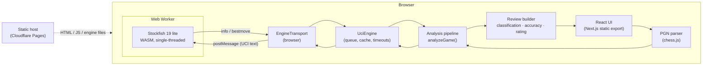
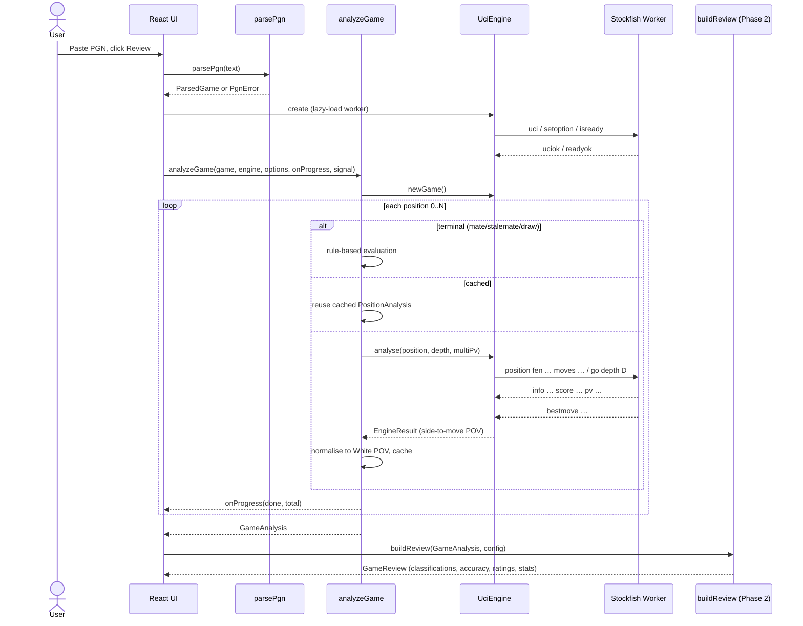

# Technical Architecture

Status key: **Final** means decided and implemented or about to be. **Validate** means a provisional choice that will be confirmed in the phase named. See `DECISIONS.md` for the reasoning behind each one.

## 1. Overall architecture

The product is a static website. Everything happens in the browser:

- The main thread parses the PGN, runs the analysis algorithms (pure TypeScript) and renders the UI.
- One dedicated Web Worker runs Stockfish (WebAssembly) and talks UCI.
- The host only serves static files (HTML, JS, CSS, the engine `.js` + `.wasm`).



There is no server-side code, database or authentication.

## 2. Technology stack and rationale

| Area | Choice | Status | Why |
|---|---|---|---|
| Framework | Next.js 16 (App Router) with `output: "export"` | Final | Requested stack; static export means no server runtime and free hosting. |
| UI | React 19, TypeScript (strict) | Final | Comes with Next.js. |
| Styling | Tailwind CSS 4 | Final | Requested; no runtime cost. |
| Chess rules / PGN | `chess.js` 1.4 (BSD-2-Clause) | Final | Maintained, handles SAN/PGN/FEN, gives verbose history with before/after FENs. |
| Engine | `stockfish` npm 19.0.1 (Stockfish.js by Nathan Rugg / Chess.com, GPL-3.0), **lite single-threaded** flavour | Final for MVP | ≈1.9 MB total, needs no cross-origin isolation, runs on every modern browser (README: Windows 10+/macOS 11+/iOS 16+/Android/Linux). The full nets are ≈94 MB, too large for a quick first load. |
| Board | `@lichess-org/chessground` 10.x (GPL-3.0-or-later) | Validate (Phase 3) | Mature, touch-friendly, has arrows and square highlights. GPL is fine because the project is GPL anyway. Fallback: `react-chessboard` (MIT). |
| Charts | Hand-written SVG component | Validate (Phase 3) | The evaluation graph is one area chart with markers; a custom SVG avoids a dependency. Fallback: Recharts (MIT). |
| State | React state + `useReducer` + context | Final | One review at a time; no global store library needed. |
| Unit tests | Vitest | Final | Fast, TypeScript-native, runs Node for real-engine integration tests. |
| Node scripts | tsx (dev only) | Final | Runs `scripts/analyze-pgn.ts` against the app's own TypeScript modules (D-020). |
| Lint / format | ESLint (Next config) + Prettier defaults | Final | Standard for contributors. |
| Hosting | Cloudflare Pages (static) | Validate (Phase 5) | Free tier, serves `.wasm` with the correct MIME type, no file-size issue (largest asset ≈1.8 MB). Vercel static works too. |

Versions are pinned in `package.json`. Library checks done on 2026-11-10 (npm registry):

| Package | Version | Licence | Last published |
|---|---|---|---|
| stockfish | 19.0.1 | GPL-3.0 | 2026-10-10 |
| chess.js | 1.4.0 | BSD-2-Clause | 2025-06-14 |
| @lichess-org/chessground | 10.5.0 | GPL-3.0-or-later | 2026-10-20 |
| recharts (fallback only) | 3.10.1 | MIT | — |

## 3. Frontend architecture

```
src/
  app/                    Next.js routes (static)
    page.tsx              Homepage: PGN input + upload + "Review game"
    review/page.tsx       Review screen (Phase 3)
    dev/engine/page.tsx   Phase 1 developer page: raw analysis output
  components/             React components (board, move list, graph, panels)
  lib/
    pgn/                  PGN parsing → ParsedGame
    engine/               Engine interface, UCI parsing, UciEngine, transports
    analysis/             Pipeline + pure calculations (evaluation, expected points,
                          classification, accuracy, rating, phases, statistics)
    review/               Builds the final GameReview object (Phase 2)
  hooks/                  useGameAnalysis etc.
public/engine/            Stockfish .js/.wasm, copied from node_modules at install time
scripts/                  copy-engine.mjs, analyze-pgn.ts (Node review CLI), benchmark tooling (Phase 4)
benchmarks/games/         sample PGNs (benchmark dataset grows here in Phase 4)
tests/                    Vitest unit and integration tests
```

Rules:

- `lib/` has no React imports and no DOM access, except `lib/engine/browserTransport.ts`. This keeps the analysis testable in Node.
- Components receive data; they do not call the engine directly. The `useGameAnalysis` hook owns the engine lifetime.

## 4. Chessboard integration (Phase 3, Validate)

- Wrap Chessground in a client component (`"use client"`), created in `useEffect` and destroyed on unmount.
- The board is view-only (`viewOnly: true`, no move input in the MVP); navigation sets `fen`, `lastMove`, `orientation` and `drawable.autoShapes` (best-move arrow).
- Classification badges are rendered as an absolutely positioned overlay on the destination square.
- Piece set: Chessground's default CSS uses pieces that are bundled separately; we will use an openly licensed set (for example cburnett, GPL/BSD-family licence) and record it in `THIRD_PARTY_NOTICES.md`. No Chess.com assets.

## 5. PGN parsing

`lib/pgn/parsePgn.ts` (Final):

1. Normalise line endings, strip a BOM, reject empty input and inputs over 1 MB.
2. If several games are present, keep the first (split on a blank line followed by a tag line `[Event`/`[`… after moves).
3. Reject `[Variant "..."]` other than `Standard`/`Chess`.
4. `chess.loadPgn(text)` (chess.js ignores comments, NAGs and variations, keeping the mainline). The chess.js error is mapped to a `PgnError` with a readable message.
5. `history({ verbose: true })` gives per-move `before`/`after` FEN, SAN, LAN, colour, piece, captured and promotion.
6. Produce `ParsedGame` (see §9) with `positions[0]` = the start position and `positions[i]` = the position after ply *i*.

## 6. Stockfish integration

- **Build:** `node_modules/stockfish/bin/stockfish-19-lite-single.{js,wasm}` copied to `public/engine/` by `scripts/copy-engine.mjs` (run by `predev`/`prebuild`/`pretest`). The engine files are not committed to git; they are redistributed unmodified.
- **Loading:** `new Worker("/engine/stockfish-19-lite-single.js")`. The `.js` file loads the `.wasm` next to it. The worker is created only when the user starts an analysis (lazy load).
- **No cross-origin isolation is needed** for the single-threaded build, so no COOP/COEP headers (which would otherwise complicate embedding and third-party resources).
- **Future upgrade path:** an optional "strong" mode could use the multi-threaded lite build when `crossOriginIsolated` is true. This needs COOP/COEP headers and is out of scope for the MVP.

## 7. Web Worker architecture

The Stockfish.js file *is* the worker script: it reads UCI commands from `postMessage` strings and posts output lines back. We do not need our own worker wrapper.

```
Main thread                                       Worker
UciEngine  ── EngineTransport.send("go …") ──▶   stockfish-19-lite-single.js
           ◀── onLine("info depth 14 …") ──
```

`EngineTransport` is the only engine-specific seam:

```ts
interface EngineTransport {
  send(command: string): void;
  onLine(listener: (line: string) => void): void;
  onError(listener: (error: Error) => void): void;
  terminate(): void;
}
```

Implementations:

- `createBrowserTransport(url)` — a `Worker`.
- `createNodeTransport()` — uses `require("stockfish")("lite-single")` with the same engine build, for tests and the benchmark CLI. Same engine, same settings, comparable output.

## 8. UCI communication

`UciEngine` (Final) handles the protocol and is engine-agnostic:

1. **Init:** `uci` → wait for `uciok` (and record `id name`); `setoption name Hash value 32`, `setoption name UCI_ShowWDL value true`, optional `Threads`; `isready` → wait for `readyok`.
2. **New game:** `ucinewgame` + `isready` once per review.
3. **Analyse position:** `setoption name MultiPV value N` (only when it changes), `position fen <startFen> moves <uci…>` (so the engine sees the move history and can detect repetitions), `go depth D` (optionally `movetime`). Collect `info` lines; the last complete line per `multipv` index wins; finish on `bestmove`.
4. **Stop:** `stop` and wait for `bestmove`, which UCI guarantees after `stop`.
5. **Serialisation:** one search at a time. Requests are queued.
6. **Timeouts:** each search has a wall-clock timeout (default 30 s per position, configurable). On timeout: `stop`; if no `bestmove` arrives within 2 s, the transport is terminated and the engine is marked failed.
7. **Reply waiters are registered before the command is sent.** Once loaded, Stockfish.js can answer synchronously inside `send()` (observed with `isready` → `readyok` in Node). Registering afterwards loses the reply and hangs. See `UciEngine.request()`.
8. **Parsing:** `lib/engine/uci.ts` contains pure functions: `parseInfoLine`, `parseBestMove`. Score bounds (`lowerbound`/`upperbound`) are ignored for the final result; only exact scores are kept when one is available.

## 9. Analysis pipeline and data structures



Core types (`lib/pgn/types.ts`, `lib/engine/types.ts`, `lib/analysis/types.ts`):

```ts
type Color = "w" | "b";

interface ParsedMove {
  ply: number;            // 1-based
  moveNumber: number;     // full-move number
  color: Color;           // mover
  san: string;
  uci: string;            // e2e4, e7e8q
  from: string; to: string;
  piece: string; captured?: string; promotion?: string;
  fenBefore: string; fenAfter: string;
}

interface ParsedGame {
  headers: Record<string, string>;
  startFen: string;
  moves: ParsedMove[];
  result: "1-0" | "0-1" | "1/2-1/2" | "*";
  warnings: string[];
}

type Score = { type: "cp"; value: number } | { type: "mate"; value: number; winner?: Color };
// value sign: positive = good for the POV side. mate value 0 = already checkmated; `winner` says who won.

interface EngineLine { multiPv: number; depth: number; score: Score; wdl?: [number, number, number]; pv: string[] }

interface PositionAnalysis {
  ply: number;                 // 0 = start position
  fen: string;
  sideToMove: Color;
  terminal?: "checkmate" | "stalemate" | "insufficient";
  evaluation: Score;           // White POV
  wdl?: [number, number, number]; // White POV (win, draw, loss) per mille
  bestMove?: string;           // UCI
  lines: EngineLine[];         // White POV, sorted by multipv
  depth: number;
  source: "engine" | "cache" | "rules";
}

interface GameAnalysis {
  game: ParsedGame;
  positions: PositionAnalysis[];   // length = moves.length + 1
  settings: { engine: string; depth: number; multiPv: number; hashMb: number };
  durationMs: number;
}
```

`GameReview` (Phase 2) adds per-move `MoveReview` (classification, expected points before/after/lost, best move, explanation inputs), per-player accuracy, rating, counts and phase breakdowns, and the `classificationVersion`.

## 10. State management

- The homepage keeps the PGN text in component state and passes it to the review route through `sessionStorage` (a convenience: if it is missing, the user is sent back to the homepage). No PGN goes into the URL in the MVP.
- The review screen uses one `useReducer` holding `{ status, progress, analysis, review, selectedPly, orientation, error }`.
- The engine instance lives in a `useRef` inside `useGameAnalysis` and is terminated on unmount.

## 11. Performance strategy

- **Lazy loading:** the engine is fetched only when analysis starts. Next.js code-splits the review route.
- **Single worker, sequential search:** a single-threaded WASM engine gains nothing from running positions in parallel on most phones; sequential search also keeps the hash table useful between consecutive positions.
- **Depth:** default `go depth 14`, MultiPV 2 (the second line is needed for "only move" detection). Both are configurable. Depth vs. accuracy is measured in Phase 4.
- **Caching:** results are cached by `FEN + depth + multiPv` for the life of the engine session. Re-running the review with the same settings costs nothing.
- **Terminal positions:** answered by rules, without engine time.
- **Progress:** reported per position. A progress bar is shown in the UI.
- **Interruptions:** cancellation uses an `AbortSignal`. Page hide on mobile: analysis continues where the browser allows; if the worker is killed, the error path offers a restart.
- **Main thread:** classification and statistics are O(n) over ≤ a few hundred plies, so they are cheap and stay on the main thread.

## 12. Deployment architecture

- `next build` with `output: "export"` produces `out/`. Cloudflare Pages serves it.
- Engine assets live at `/engine/…` with long-lived cache headers (versioned file names include the Stockfish version).
- No environment secrets. No server functions.

## 13. Security and privacy

- PGN text is processed locally; it is never sent anywhere. There are no analytics or third-party scripts in the MVP.
- PGN input is treated as untrusted: size-limited, parsed by chess.js, never injected as HTML (React escapes text).
- Content Security Policy (Phase 5): `script-src 'self' 'wasm-unsafe-eval'`, `worker-src 'self'`, no remote origins.

## 14. Third-party dependencies and licensing

- **Stockfish / Stockfish.js — GPL-3.0.** We redistribute the unmodified engine files. Obligations: ship the licence text, give a prominent notice, and provide access to the corresponding source (link to the exact release tag of `nmrugg/stockfish.js` v19.0.1 and to official Stockfish).
- **Chessground — GPL-3.0-or-later** (Phase 3). Bundled into our JS, so our distributed code must be GPL-compatible.
- **Project licence: GPL-3.0-or-later** (see `DECISIONS.md` D-004). This satisfies both and keeps the project open.
- **chess.js — BSD-2-Clause.** Notice kept in `THIRD_PARTY_NOTICES.md`.
- We do not copy code from Lichess (`lila` is AGPL-3.0). Where we follow a publicly documented Lichess method (win-probability curve, accuracy formula), we implement it ourselves from the published description and cite the source.
- No Chess.com assets, logos, icons or trade dress are used.

## 15. References

- Stockfish.js: https://github.com/nmrugg/stockfish.js (README for v19.0.1 in the npm package)
- Stockfish: https://github.com/official-stockfish/Stockfish
- UCI protocol: https://backscattering.de/chess/uci/
- chess.js: https://github.com/jhlywa/chess.js
- Chessground: https://github.com/lichess-org/chessground
- Cross-origin isolation guide: https://web.dev/articles/cross-origin-isolation-guide
